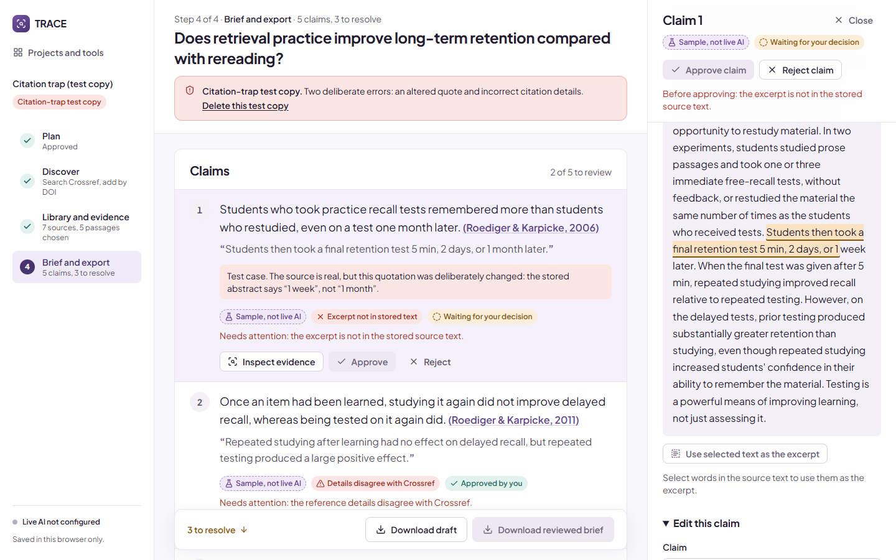

# TRACE — Research you can defend.

A reference manager with a bounded AI research assistant, built for the AI Club Hackathon 2026. A student finds real sources, reads the evidence, approves what to use, and exports a short brief in which every claim points to the stored passage behind it, with APA 7 references and an honest AI-use disclosure.

**A real DOI does not make a claim supported.** TRACE keeps five questions apart and never merges them into one "verified" badge:

1. **Reference identity** — do the cited title, first author and year agree with Crossref's record for that DOI?
2. **Evidence access** — an abstract, a passage the student pasted, or no text at all.
3. **Excerpt integrity** — is the quoted excerpt really in the stored text? (deterministic text match)
4. **Support assessment** — the AI's own suggestion, labelled as fallible.
5. **Student decision** — pending, approved, rejected, or stale after an edit.



## Run it

Needs Node 22.12 or later.

```
npm ci
npm run dev
```

Open http://localhost:3000 and choose **Open the demo project** for the full workflow, or **Run the citation trap** to see a blocked reviewed export. No configuration is needed.

For a production build on a laptop:

```
npm run build
npm start
```

## What works in each mode

| | No keys (default) | With `GEMINI_API_KEY` |
|---|---|---|
| Crossref search, DOI lookup, citation checking | live | live |
| OpenAlex abstract fallback | live | live |
| Library: tags, notes, filters, duplicate prevention | yes | yes |
| Check a pasted reference list (up to 15) | live | live |
| Writing space with live in-text citation checks; APA 7 or Harvard | yes | yes |
| Retraction notices from Crossref | live | live |
| Rules in force (AI drafting on/off, oldest year, block retracted) | yes | yes |
| Excerpt, claim-details, identity, approval and export checks | yes | yes |
| APA 7 references, Markdown brief, JSON backup | yes | yes |
| Hand-written claims linked to passages | yes | yes |
| "Draft with AI" | disabled, and says why | one structured call over the approved passages |
| "Load sample brief (not live AI)" | demo project only, labelled as a sample | same |

With the local server running, the demo project, sample brief, citation trap and citation formatting work without internet access. Live lookups and AI drafting require a connection.

## Configuration

Copy `.env.example` to `.env.local`. Every value is optional.

| Variable | Purpose |
|---|---|
| `GEMINI_API_KEY` | Enables live drafting. Server-side only. Free key from Google AI Studio. |
| `GEMINI_MODEL` | Overrides the default model, `gemini-3.5-flash-lite`. |
| `CROSSREF_MAILTO` | A contact email for Crossref's faster polite pool. Sent to Crossref with each request. |
| `OPENALEX_API_KEY` | Raises OpenAlex's daily budget. Not needed for DOI lookups. |

On Gemini's free tier, Google may use submitted content to improve its products and reviewers may read it. TRACE sends only the research question and the passages the student approved, and shows that request in full beforehand.

## Checks

```
npm run typecheck     # TypeScript, strict
npm run lint          # ESLint
npm test              # unit tests (Vitest); no network
npm run test:e2e      # builds the app and runs browser journeys in the installed Edge
npm run smoke:live    # real Crossref, OpenAlex, Citation.js and (with a key) Gemini calls; needs the app running
```

Automated tests use fixtures that are labelled as test fixtures and never call a paid or rate-limited API. Results of the last full run are in [docs/qa-report.md](docs/qa-report.md).

`npm run test:e2e` uses the Edge browser already on Windows. On another system: `npx playwright install chromium`, then `PW_CHANNEL=chromium npm run test:e2e`.

## The citation trap

**Run the citation trap** on the welcome screen or in **Projects and tools** opens a separate, labelled test copy with two planted errors: a real DOI whose cited year and author order were altered, and a real source with a quotation changed from "1 week" to "1 month". The normal validators catch both. The reviewed export is blocked until each is corrected, and fixing one clears only that one.

## Deploy

Any Node host works. For Vercel: import the repository, add `GEMINI_API_KEY` under Environment Variables, deploy. Steps and a post-deploy check are in [docs/submission-checklist.md](docs/submission-checklist.md). Deployment status is recorded in [PROGRESS.md](PROGRESS.md); this README does not claim the app is deployed.

## Limits

- Evidence is abstract-only unless the student pastes a passage. Full papers are not read.
- A matched excerpt shows the words are in the stored text. It does not show the paper is right, or that the claim follows from the words.
- The AI's support rating can be wrong. TRACE never scores support itself.
- Crossref has no abstract for many papers, and a search of one registry is not a systematic review.
- References keep the registry's title capitalisation (APA 7 asks for sentence case), and the a/b order of same-author, same-year works follows the CSL processor.
- Work is saved in this browser only. It is not a cloud backup. The activity history is a convenience, not an audit trail.
- Rate limiting and caching are in memory and per server instance.
- TRACE does not detect plagiarism, certify work, or stand in for an institution's academic-integrity rules. It is a hackathon MVP, not production software.

## Where things are

```
src/app/            the page and the API routes
src/components/     workspace UI: steps, Claim Inspector, sidebar
src/lib/            domain core (pure, tested); src/lib/server/ = provider adapters
src/data/           real Crossref fixtures and the labelled sample brief
tests/unit/         Vitest
tests/e2e/          Playwright journeys
scripts/            fixture fetch, live smoke test
docs/               brief, rubric map, decisions, architecture, prompt log, QA, playbooks, screenshots
submissions/        Phase 1 deck with its generator; Phase 2 submission text
```

Start with [docs/architecture-and-governance.md](docs/architecture-and-governance.md) for how it fits together, and [docs/demo-and-qa.md](docs/demo-and-qa.md) for the eight-minute walkthrough. `MASTER_PROMPT.md`, `START_HERE.md` and `RESEARCH_SOURCES.md` are the original kit files this project was built from.

## Credits

Built with Next.js, React, Tailwind CSS, zod, lucide-react, Citation.js (with citeproc-js), the Google Gen AI SDK, Vitest and Playwright. Font: Plus Jakarta Sans, self-hosted under the SIL Open Font License. Visual style modelled on ReproSense. Bibliographic data from Crossref and OpenAlex. Versions and licences: [docs/research-and-decisions.md](docs/research-and-decisions.md). Abstracts in the demo fixtures remain the copyright of their publishers.

Claude Code and Codex helped build and review the project. The main requests are recorded in [the prompt log](docs/prompt-log.md).
